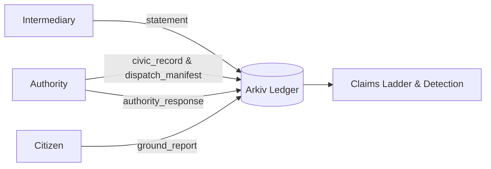

<div align="center">
<!-- DEMO VIDEO: replace the line below with the YouTube link -->
Demo video: YOUTUBE_LINK_HERE
</div>

<div align="center">

<pre>
██╗  ██╗██████╗ ██╗██╗  ██╗
██║ ██╔╝██╔══██╗██║╚██╗██╔╝
█████╔╝ ██████╔╝██║ ╚███╔╝ 
██╔═██╗ ██╔══██╗██║ ██╔██╗ 
██║  ██╗██║  ██║██║██╔╝ ██╗
╚═╝  ╚═╝╚═╝  ╚═╝╚═╝╚═╝  ╚═╝
</pre>
</div>

<div align="center">
<b>They can edit their status. Not your voice.</b>
<br>
Jo likha, wo likha.
</div>

<div align="center">


</div>

---

<div align="center">

[Live app](LIVE_URL_HERE) | [Demo video](YOUTUBE_LINK_HERE) | [Schema](/arkiv/schema.md) | [Friction report](/arkiv/friction.md)

</div>

## The problem

In public distribution programmes across India, such as rural medicine deliveries, disaster relief packets, or local water works, official records often mark supplies as delivered while communities on the ground experience shortages or damaged goods. When citizens file complaints on centralized grievance portals, records can be edited, closed, or silently deleted by administrators who control the database. Local residents and field workers bear the harm of missing supplies while official dashboards report complete success. There is no independent, tamper-proof record that preserves both the original promise and field observations side by side.

## The solution

Krix is an accountability ledger for public delivery commitments built on Arkiv. An authority publishes a delivery promise detailing item counts, destination villages, and dispatch dates. Residents and facility staff submit eyewitness reports and statements on whether supplies arrived, logging observed counts and photo proofs. The authority can publish official replies, and residents record condition verdicts. Neither side can edit or delete the other party's submissions. The interface labels official delivery states as "authority claims" and presents claims alongside resident reports so discrepancies remain permanently visible.

## How it works



1. An authority publishes a delivery commitment, creating a mutable `civic_record` and an immutable `dispatch_manifest`.
2. Intermediate transport or warehouse handlers submit readonly `statement` entities recording handover counts and cargo condition.
3. Local residents and health workers submit readonly `ground_report` entries with observed counts, damage verdicts, and IPFS photo CIDs.
4. The authority submits an immutable `authority_response` referencing a specific complaint or statement key.
5. The authority updates delivery progress by patching whitelisted fields on `civic_record` without overwriting the genesis manifest.
6. The client-side detection engine cross-references all claims chronologically and flags discrepancies between promised and reported numbers.

## Built with

| Layer | What we used |
|---|---|
| Frontend | Next.js 15, React 19, TypeScript |
| Wallet and Chain | Viem 2.57.7 |
| Web3 Database SDK | @arkiv-network/sdk 0.8.1 |
| Network | Tiramisu testnet (Chain ID 7738577) |
| Media Storage | IPFS for photos (only CIDs stored on chain) |
| Testing | Vitest 5.0.5 |
| Deployment | Node.js 18+ / Next.js production build |

### How Arkiv is used

- Readonly entities: `dispatch_manifest`, `ground_report`, `statement`, and `authority_response` use `readonly: true` so records cannot be altered after publication.
- Permissionless extension: Secondary entities use `permissionlessExtension: true` so anyone can extend storage lifetime using `$GLM` tokens.
- Field whitelisting with `patchEntity`: Used only on `civic_record` to update status, received count, and notes while protecting dispatch parameters.
- Custody succession with `changeOwnership`: Transfers on-chain write authority to successor custodian wallets while preserving historical creator wallets.
- Historical inspection with `atBlock`: Allows queries at specific block numbers to detect retroactive status edits.
- Attribute indexing: Uses typed attributes (`str`, `i32`, `u64`) to filter entities by type and parent promise key.

See [/arkiv/schema.md](/arkiv/schema.md) for complete technical specifications.

## Run it locally

### Prerequisites

Node.js 18 or higher, npm, and a Web3 browser wallet (such as MetaMask). Reading data from Arkiv requires no wallet. Submitting records requires a wallet with testnet `$GLM` on Tiramisu.

### Setup

```bash
git clone https://github.com/Shivangi-Sharma06/krix.git
cd krix
npm install
cp .env.example .env.local
```

### Environment variables

| Variable | Description |
|---|---|
| `NEXT_PUBLIC_CHAIN_ID` | Tiramisu testnet chain ID (`7738577`). |
| `NEXT_PUBLIC_RPC_URL` | Arkiv RPC URL (`https://rpc.tiramisu.db-chain.testnet.arkiv.network`). |
| `NEXT_PUBLIC_EXPLORER_URL` | Arkiv block explorer URL (`https://tiramisu.explorer.arkiv.network`). |
| `NEXT_PUBLIC_FAUCET_URL` | Arkiv testnet faucet URL (`https://hub.arkiv.network/faucet`). |
| `NEXT_PUBLIC_DEMO_MODE` | Set to `false` for live blockchain mode, or `true` for offline simulation. |
| `SEED_PRIVATE_KEY` | Throwaway testnet private key used by seed script. Never use real funds. |
| `NEXT_PUBLIC_IPFS_GATEWAY` | IPFS gateway URL (defaults to `https://ipfs.io/ipfs/`). |
| `PINATA_JWT` | Optional Pinata token for remote pinning. |

Get testnet `$GLM` tokens from https://hub.arkiv.network/faucet.

### Seed, test, and run

```bash
# Seed a multi-party scenario to the live testnet
npm run seed

# Run unit tests
npm test

# Run development server
npm run dev

# Run production build
npm run build
npm run start
```

Open http://localhost:3000 in your browser. To test both roles, connect two separate wallet accounts: the account that creates a promise is the authority, and other accounts act as citizens or intermediaries.

## Project structure

```text
├── app/          # Next.js App Router routes (authority, citizen, party, records)
├── components/   # React components (claims ladder, header, submit report modal)
├── lib/          # Arkiv SDK client, cover-up detection, IPFS handling, types
├── arkiv/        # Schema definition and engineering friction reports
├── scripts/      # On-chain scenario seed script
└── public/       # Static assets and logo
```

## Wallets and data

The wallet addresses that create entities are listed in [/arkiv/wallets.md](/arkiv/wallets.md). All seed and test records use synthetic data. No personal data, passwords, or private keys are stored on chain.

## License

MIT. See [LICENSE](LICENSE).
