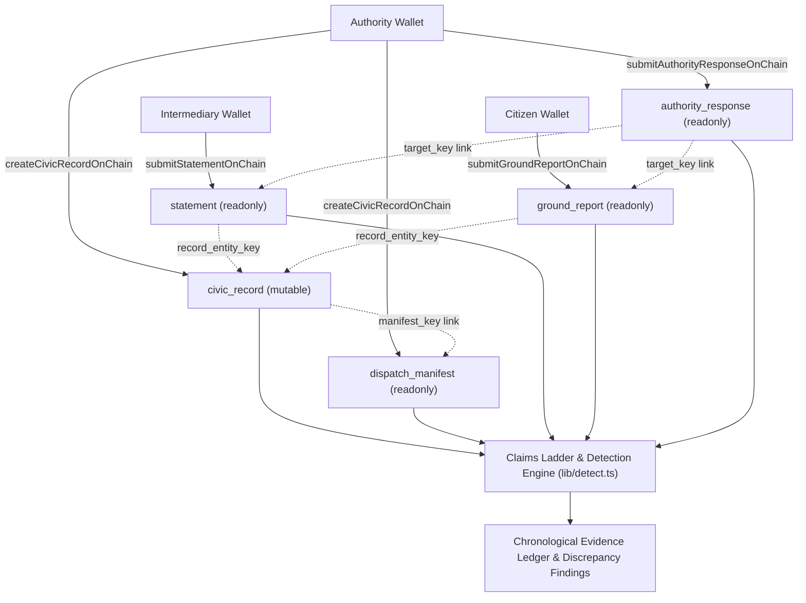

# Arkiv Entity Schemas: Krix

Krix stores public commitments and ground reality observations on Arkiv on the Tiramisu Testnet (chain ID 7738577) using `@arkiv-network/sdk` version 0.8.1. The guiding architectural principle is separating official declarations from field observations so that neither side can edit, overwrite, or delete the other side's words. An authority publishes a delivery promise, intermediaries submit operational transit statements, and citizens submit eyewitness reports and complaints. Because every entity is anchored to cryptographic keys on Arkiv, discrepancies between promised quantities and observed realities remain visible, permanent, and verifiable.

## 1. Summary of Entity Types

| Entity Type | Who Writes It | Readonly | Permissionless Extension | Mutable via `patchEntity` | Expiration / Lifetime | Purpose |
|---|---|---|---|---|---|---|
| `civic_record` | Authority / Current Custodian | `false` | `false` | Yes (`status`, `quantity_received`, `notes`, `manifest_key`) | 365 days (`fromDays(365)`) | The official mutable public promise and claimed status. |
| `dispatch_manifest` | Authority (at creation) | `true` | `true` | No | 365 days (`fromDays(365)`) | Immutable genesis snapshot of dispatched quantities and destinations. |
| `ground_report` | Citizens (residents, inspectors, doctors) | `true` | `true` | No | 30 days (`fromDays(30)`) | Citizen eyewitness observations, condition verdicts, and photo proofs. |
| `statement` | Intermediaries (transport, distributors, clinic staff) | `true` | `true` | No | 30 days (`fromDays(30)`) | Readonly operational transit statements and handover counts. |
| `authority_response` | Authority / Custodian | `true` | `true` | No | 30 days (`fromDays(30)`) | Formal, immutable official response to a specific complaint or statement. |

---

## 2. Entity Specifications

### `civic_record`

#### Purpose
Represents an official public promise or distribution batch published by a government authority (for example, medicine batches, disaster relief kits, or civic works). It is mutable only by the current on-chain custodian for operational updates, such as logging transit progress or recording delivered counts.

#### Flags and Lifetime
- `readonly`: `false`
- `permissionlessExtension`: `false`
- `expires`: `ExpirationTime.fromDays(365)` (1 year default)

#### Payload Example
```json
{
  "type": "civic_record",
  "reference_code": "KX-MED-GNT-2026-DEMO01",
  "manifest_key": "0x89abcdef0123456789abcdef0123456789abcdef0123456789abcdef01234567",
  "kind": "MEDICINE_BATCH",
  "title": "500 Dengue Testing Kits",
  "quantity_dispatched": 500,
  "quantity_received": 0,
  "status": "IN_TRANSIT",
  "origin": "State Warehouse, Vijayawada",
  "destination": "PHC Mangalagiri",
  "expiry_date": "2027-03-31",
  "district": "Guntur",
  "ward_id": "W-12",
  "notes": "Dispatched in cold storage truck AP-16-TX-1024"
}
```

#### Indexed Attributes
- `type`: `str('civic_record')`
- `reference_code`: `str(record.reference_code)`
- `kind`: `str(record.kind)`
- `status`: `str(record.status)`
- `district`: `str(record.district)`
- `ward_id`: `str(record.ward_id)`
- `quantity_dispatched`: `u64(BigInt(record.quantity_dispatched))`
- `manifest_key`: `str(manifestKey)` (indexed when patched at genesis)
- `quantity_received`: `u64(BigInt(record.quantity_received))` (indexed when patched)

*Unindexed in attributes:* `title`, `origin`, `destination`, `expiry_date`, and `notes` live solely inside the JSON payload.

#### Enforcement and Permissions
Enforced in `lib/arkiv.ts` by `createCivicRecordOnChain` and `patchCivicRecordOnChain`. Only the connected wallet that matches the live on-chain `owner` attribute can call `patchEntity` or `changeOwnership`. The application adapter enforces a strict whitelist: only `status`, `quantity_received`, and `notes` can be updated. Any attempt to modify origin parameters (`quantity_dispatched`, `origin`, `destination`) is rejected prior to dispatch.

#### Why Arkiv Is Needed
If an official marks a shipment as delivered when it arrived damaged, Arkiv retains the block timestamp and transaction history of every edit. In standard databases, updating a row overwrites the prior state. On Arkiv, even when `patchEntity` updates the active record, historical snapshots remain verifiable at previous block heights.

#### What Breaks on Alternatives
- **Postgres / SQL:** A database administrator or compromised service account can run `UPDATE civic_records SET status = 'DELIVERED'` without leaving an immutable audit trail.
- **IPFS:** IPFS content addressing is immutable, but does not provide mutable pointers or access control. It cannot enforce that only the current custodian can update the status.
- **Subgraph:** A subgraph only indexes EVM events emitted by contracts. It does not provide an uncensorable write interface or native entity storage.
- **Private API:** A backend service can silently drop failed handovers or modify logs before exposing them to client dashboards.

---

### `dispatch_manifest`

#### Purpose
Created alongside `civic_record` during the initial transaction as an immutable companion entity. It locks in the original quantity, dispatch date, origin, and destination at genesis so that the authority cannot retroactively alter what was initially promised.

#### Flags and Lifetime
- `readonly`: `true`
- `permissionlessExtension`: `true`
- `expires`: `ExpirationTime.fromDays(365)` (1 year default)

#### Payload Example
```json
{
  "type": "dispatch_manifest",
  "record_entity_key": "0x1234567890abcdef1234567890abcdef1234567890abcdef1234567890abcdef",
  "reference_code": "KX-MED-GNT-2026-DEMO01",
  "kind": "MEDICINE_BATCH",
  "quantity_dispatched": 500,
  "expiry_date": "2027-03-31",
  "origin": "State Warehouse, Vijayawada",
  "destination": "PHC Mangalagiri",
  "creator_wallet": "0xc360b9fbb59eddb38042745d315661409ad16cf9"
}
```

#### Indexed Attributes
- `type`: `str('dispatch_manifest')`
- `record_entity_key`: `str(recordKey)`
- `reference_code`: `str(record.reference_code)`

*Unindexed in attributes:* `kind`, `quantity_dispatched`, `origin`, `destination`, `expiry_date`, and `creator_wallet` reside in the payload.

#### Enforcement and Permissions
Created inside `createCivicRecordOnChain` in `lib/arkiv.ts`. Because `readonly: true` is passed during entity creation, the Arkiv protocol rejects any subsequent `patchEntity` call on this key.

#### Why Arkiv Is Needed
Prevents revisionism. If an authority promises 500 kits but later modifies the `civic_record` to state that only 300 kits were dispatched, the detection engine compares the mutable record against this immutable `dispatch_manifest` and immediately flags a tampering finding.

#### What Breaks on Alternatives
- **Postgres / SQL:** Foreign key relationships can be cascaded or rows updated if admin credentials are compromised.
- **IPFS:** IPFS can store the static JSON, but cannot link it to an active, queryable entity table with automatic expiration management.
- **Subgraph:** A subgraph can record an event, but cannot prevent the underlying application from ignoring old events unless smart contracts enforce it.
- **Private API:** A private API can alter internal records before displaying dispatch manifests to auditors.

---

### `ground_report`

#### Purpose
Enables citizens, clinic doctors, and local inspectors to file eyewitness reports regarding the actual condition and count of goods delivered to their community.

#### Flags and Lifetime
- `readonly`: `true`
- `permissionlessExtension`: `true`
- `expires`: `ExpirationTime.fromDays(30)` (30 days default)

#### Payload Example
```json
{
  "type": "ground_report",
  "record_entity_key": "0x1234567890abcdef1234567890abcdef1234567890abcdef1234567890abcdef",
  "severity": 9,
  "verdict": "DAMAGED",
  "count_received": 300,
  "description": "Cartons soaked in water, broken seals, vials cracked upon opening.",
  "photo_cids": [
    "bafybeidvl63fgh4g2rtd6g4a33tewxupk2c27bkjffvhjklmno3pqr4stu"
  ],
  "reporter_role": "DOCTOR",
  "location": "PHC Mangalagiri OPD",
  "is_custodian_submission": false
}
```

#### Indexed Attributes
- `type`: `str('ground_report')`
- `record_entity_key`: `str(report.record_entity_key)`
- `verdict`: `str(report.verdict)` (`DAMAGED` | `EXPIRED` | `SHORT_QUANTITY` | `NOT_RECEIVED` | `ALL_GOOD`)
- `severity`: `i32(report.severity)` (1 to 10)
- `reporter_role`: `str(report.reporter_role)` (`DOCTOR` | `INSPECTOR` | `CITIZEN`)

*Unindexed in attributes:* `count_received`, `description`, `photo_cids`, `location`, and `is_custodian_submission` remain in the payload.

#### Enforcement and Permissions
Enforced in `lib/arkiv.ts` by `submitGroundReportOnChain` and UI modals:
- The referenced `record_entity_key` must be a valid 32-byte hex string.
- Authority wallets are blocked from submitting ground reports (authorities issue promises, status updates, and official responses).
- Client-side rate-limiting enforces a maximum of 3 reports per wallet per record per day.
- Photos are restricted to a maximum of 3 items, verified by magic bytes and stripped of EXIF GPS metadata.

#### Why Arkiv Is Needed
Reports cannot be deleted or silenced. If a local official receives complaints about spoiled medicines, they cannot expunge the negative reports from the database. Furthermore, `permissionlessExtension: true` allows civic oversight groups or journalists to extend the storage lifetime of critical complaint records without needing the original author's private key.

#### What Breaks on Alternatives
- **Postgres / SQL:** A database administrator can delete unfavorable citizen submissions (`DELETE FROM ground_reports WHERE verdict = 'DAMAGED'`).
- **IPFS:** While individual IPFS files are uncensorable, there is no shared query mechanism to fetch all reports referencing a specific promise key without an external indexer.
- **Subgraph:** A subgraph can index reports emitted as EVM events, but gas costs for storing arbitrary text descriptions and multiple IPFS hashes directly on EVM storage are prohibitive. Arkiv provides native payload storage with low gas costs.
- **Private API:** Centralized servers can throttle or filter submissions from specific IP ranges or districts.

---

### `statement`

#### Purpose
Allows intermediaries (transport drivers, warehouse distributors, clinic staff) to submit optional, readonly operational claims about counts and cargo condition at various transit points. Intermediaries are treated as another independent voice on the Claims Ladder rather than an authoritative tracking mechanism.

#### Flags and Lifetime
- `readonly`: `true`
- `permissionlessExtension`: `true`
- `expires`: `ExpirationTime.fromDays(30)` (30 days default)

#### Payload Example
```json
{
  "type": "statement",
  "record_entity_key": "0x1234567890abcdef1234567890abcdef1234567890abcdef1234567890abcdef",
  "party_type": "DISTRIBUTOR",
  "location": "in transit",
  "received_count": 480,
  "passed_on_count": 480,
  "condition": "DAMAGED",
  "note": "Received 480 boxes at regional hub; 20 boxes soaked during rain, moisture on outer seals.",
  "photo_cids": [
    "bafybeidvl63fgh4g2rtd6g4a33tewxupk2c27bkjffvhjklmno3pqr4stu"
  ],
  "event_date": "2026-10-17"
}
```

#### Indexed Attributes
- `type`: `str('statement')`
- `record_entity_key`: `str(statement.record_entity_key)`
- `party_type`: `str(statement.party_type)` (`TRANSPORT` | `DISTRIBUTOR` | `FACILITY_STAFF` | `OTHER`)
- `condition`: `str(statement.condition)` (`OK` | `DAMAGED` | `EXPIRED` | `SHORT` | `DELAYED`)
- `location`: `str(statement.location)` (chosen from promise destination/village list or "in transit")
- `received_count`: `i32(statement.received_count)` (optional integer >= 0)
- `passed_on_count`: `i32(statement.passed_on_count)` (optional integer >= 0)

*Unindexed in attributes:* `note`, `photo_cids`, and `event_date` are stored in the payload.

#### Enforcement and Permissions
Enforced in `lib/arkiv.ts` by `submitStatementOnChain`:
- `party_type` must be in `['TRANSPORT', 'DISTRIBUTOR', 'FACILITY_STAFF', 'OTHER']`.
- `condition` must be in `['OK', 'DAMAGED', 'EXPIRED', 'SHORT', 'DELAYED']`.
- Location must be explicitly chosen from the destination village list or `"in transit"` (no free-text location injection).
- Counts must be non-negative integers.
- Notes are bounded to 500 characters, and photo attachments are capped at 3 IPFS CIDs.

#### Why Arkiv Is Needed
Intermediaries frequently face conflicting pressure during disputes over missing inventory. On Arkiv, a statement made by a transport driver cannot be edited, retracted, or coerced into silence after submission.

#### What Breaks on Alternatives
- **Postgres / SQL:** Logistics systems frequently overwrite checkpoint entries when shipments are updated or rerouted.
- **IPFS:** IPFS cannot validate structured attribute queries such as finding all statements where `condition = 'DAMAGED'`.
- **Subgraph:** Standard subgraphs cannot validate business logic constraints or rate-limiting rules at write time.
- **Private API:** Supply chain tracking APIs are typically permissioned and managed by the vendor, who has an incentive to hide transit damage.

---

### `authority_response`

#### Purpose
Enables the authority or current custodian to publish an official, immutable response to a specific citizen complaint or intermediary statement, maintaining two-sided accountability on the Claims Ladder.

#### Flags and Lifetime
- `readonly`: `true`
- `permissionlessExtension`: `true`
- `expires`: `ExpirationTime.fromDays(30)` (30 days default)

#### Payload Example
```json
{
  "type": "authority_response",
  "record_entity_key": "0x1234567890abcdef1234567890abcdef1234567890abcdef1234567890abcdef",
  "target_key": "0xfa1234567890abcdef1234567890abcdef1234567890abcdef1234567890bcde",
  "target_type": "complaint",
  "response_text": "Replacement shipment of 200 kits has been dispatched via emergency reserve order KX-EMG-04.",
  "official_role": "District Health Authority"
}
```

#### Indexed Attributes
- `type`: `str('authority_response')`
- `record_entity_key`: `str(response.record_entity_key)`
- `target_key`: `str(response.target_key)`
- `target_type`: `str(response.target_type)` (`'complaint'` | `'statement'`)

*Unindexed in attributes:* `response_text` and `official_role` are stored in the JSON payload.

#### Enforcement and Permissions
Enforced in `lib/arkiv.ts` by `submitAuthorityResponseOnChain`:
- The target reference (`target_key`) and the promise link (`record_entity_key`) must be valid 32-byte hex keys.
- `response_text` must be non-empty.
- The entity is published as readonly, meaning authorities cannot rewrite their formal explanations later if facts change.

#### Why Arkiv Is Needed
Guarantees parity between citizen claims and official rebuttals. If an authority explains that a shortage was caused by flood diversions, that explanation cannot later be deleted when audit teams investigate.

#### What Breaks on Alternatives
- **Postgres / SQL:** Government feedback portals frequently allow moderators to redact or unpublish official replies.
- **IPFS:** An unindexed IPFS file cannot be efficiently grouped under a specific target complaint key.
- **Subgraph:** Emitting responses as raw smart contract events requires custom solidity contract deployments and higher gas overhead.
- **Private API:** Centralized moderation teams can curate which official answers remain public.

---

## 3. How We Use Each Arkiv Feature

| Feature | Where Used in Code | Purpose and Rationale |
|---|---|---|
| `readonly: true` | `lib/arkiv.ts` (`createEntity` for `dispatch_manifest`, `ground_report`, `statement`, `authority_response`) | Enforces immutability at the protocol level. Once published, citizen complaints, driver statements, and manifests cannot be altered or retracted by any party. |
| `permissionlessExtension: true` | `lib/arkiv.ts` (`createEntity` for all secondary entities) | Allows anyone (journalists, legal teams, civic monitors) to extend an entity's storage lifetime by paying gas tokens, preventing critical evidence from expiring. |
| `patchEntity` | `lib/arkiv.ts` (`patchCivicRecordOnChain`) | Used exclusively on the mutable `civic_record` to update `status`, `quantity_received`, and `notes`. A strict client whitelist in `lib/arkiv.ts` prevents modification of core dispatch parameters. |
| `changeOwnership` | `lib/arkiv.ts` (`changeRecordCustodyOnChain`) | Used strictly for custodian handover and officer succession. Transfers on-chain write authority to the next custodian wallet while preserving previous custodians in the immutable transaction history. |
| `atBlock` | `lib/arkiv.ts` (`fetchCivicRecordByKey`, `fetchGroundReports`, `fetchStatements`), `lib/detect.ts` | Allows queries to reconstruct the exact state of entities at any past block height, enabling deterministic detection of status reversals and timeline anomalies. |
| Attribute Queries | `lib/arkiv.ts` (`fetchCivicRecords`, `fetchGroundReports`, etc.) | Queries records using typed attributes (`type = str('civic_record')`, `record_entity_key = str(...)`, `verdict = str(...)`, `severity = i32(...)`) with limit pagination. |
| `extendEntity` | `lib/arkiv.ts` (`extendEntityLifetimeOnChain`) | Renews storage duration on-chain via Arkiv's Lifetime Extension primitive, adding 30 or 365 days to prevent pruning. |

---

## 4. What We Deliberately Kept Off Arkiv

1. **Raw Photos and Heavy Media:** Image binaries are never stored on Arkiv. Photos are validated on the client, stripped of EXIF metadata via canvas re-encoding, and pinned to IPFS. Only deterministic IPFS CIDv1 strings are stored in Arkiv payloads.
2. **Personally Identifiable Information (PII):** No names, phone numbers, home addresses, Aadhaar numbers, or national IDs are collected or stored in plaintext or hashed form. Roles (such as doctor, inspector, or transport driver) are self-declared.
3. **Exact GPS Coordinates:** Mobile location data is stripped before upload. In the citizen form, location labels are selected from the promise destination list or coarse village names to prevent tracking residents.
4. **Private Keys and Passwords:** All authentication is delegated to standard Web3 wallet signing. No credentials or session tokens are stored on chain.
5. **Derived Analytics and Detection Scores:** The cover-up detection score (0–100) and Claims Ladder findings are calculated client-side in pure TypeScript (`lib/detect.ts`). Storing derived scores on chain would risk becoming stale whenever new statements are added.

Arkiv entities are public and permanent throughout their lifetime. Keeping private data and raw media off-chain protects citizen privacy and conserves blockchain state storage.

---

## 5. Data Flow



1. **Promise Creation:** The authority publishes a delivery promise (`createCivicRecordOnChain`). This produces a mutable `civic_record` and an immutable `dispatch_manifest` locking in the initial quantity and route.
2. **Transit Checkpoints:** Intermediary drivers or depot handlers log checkpoints (`submitStatementOnChain`), creating readonly `statement` entities linked to the promise key.
3. **Citizen Eyewitness:** Upon arrival (or failure to arrive), local residents or doctors file reports (`submitGroundReportOnChain`) with damage verdicts and IPFS photo CIDs.
4. **Official Response:** If discrepancies arise, the authority can respond to a specific complaint or statement (`submitAuthorityResponseOnChain`).
5. **Reconciliation & Cover-Up Check:** The client-side detection engine (`lib/detect.ts`) cross-references the manifest, citizen verdicts, intermediary statements, and status revisions, flagging discrepancies neutrally on the Claims Ladder.

---

## 6. Known Limitations

1. **Pseudonymous Wallets:** Any wallet can submit citizen reports or intermediary statements. While the detection engine requires multiple distinct wallets ($K \ge 3$) and excludes authority wallets, on-chain pseudonyms do not guarantee sybil resistance without external decentralized identity or proof-of-humanity systems.
2. **No Physical Truth Proof:** Krix demonstrates when claims disagree; it does not prove where physical items were diverted or which party was responsible.
3. **Storage Expiration:** Arkiv entities expire unless renewed. If neither the community nor an oversight group calls `extendEntity`, entities will eventually be pruned from storage.
4. **Client-Side Enforcement:** Rate limits (3 reports per wallet per day) and field whitelisting are enforced by the application layer. A caller sending raw transactions directly to the Arkiv precompile could bypass client checks, although `readonly: true` flags remain strictly enforced by the Arkiv protocol.
5. **Lack of On-Chain Referential Integrity:** Arkiv treats entities as independent key-value items. The protocol does not reject a statement that references a non-existent `record_entity_key`; validating reference integrity is handled by the application query layer.
